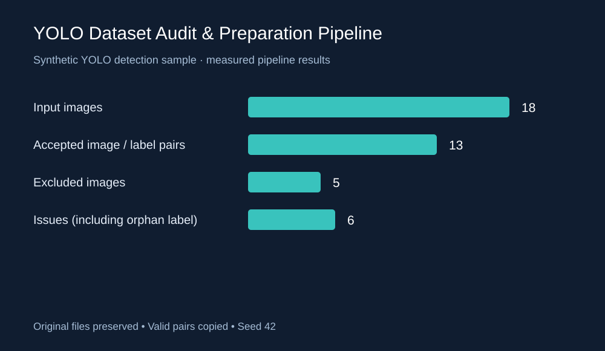
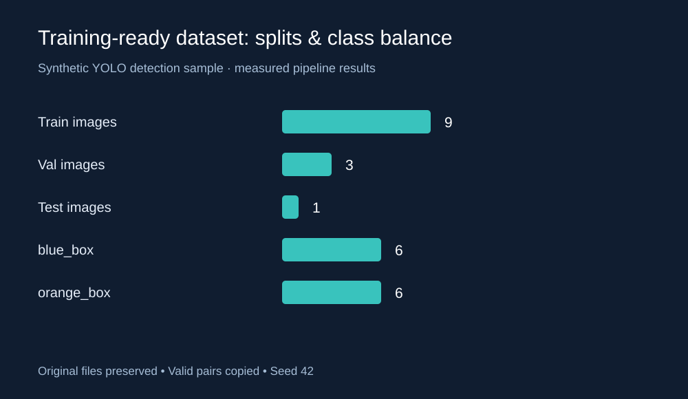

# YOLO Dataset Audit & Preparation Pipeline

Turn raw YOLO detection annotations into a validated, training-ready folder. Pure Python standard library; no installation, paid APIs, or UI required. Tested with Python 3.13; Python 3.10+ supported.

## Run

From this folder:

```bash
python pipeline.py --input sample_input --output prepared_dataset --classes blue_box orange_box
python -m unittest -v
```

Use a **new output directory** each time. Existing output folders are rejected to prevent accidental overwrites. Input/output paths cannot overlap. Originals are read and copied, never edited.

For your own dataset, supply class names in class-ID order:

```bash
python pipeline.py --input raw_dataset --output prepared_custom --classes person vehicle --ratios 0.7 0.2 0.1 --seed 42
```

The reusable `audit(source, names)` and `prepare(source, output, names, ratios, seed)` functions live in one file. Audit results and split membership are saved in `report.json`; `report.md` is the human-readable summary.

## Sample input and output

```text
sample_input/
  images/                   # 18 original synthetic 128 x 128 PNGs
    item_00.png
    bad_box.png
    missing_label.png
    ...
  labels/                   # 18 YOLO annotation files
    item_00.txt
    bad_box.txt
    missing_image.txt
    ...

sample_output/
  images/{train,val,test}/   # 9 / 3 / 1 copied images
  labels/{train,val,test}/   # matching annotations
  dataset.yaml
  report.json
  report.md
```

Each annotation line is `class_id center_x center_y width height`, with normalized coordinates. An empty label is a valid background image. Class names are `blue_box` and `orange_box`; the images are deliberately simple colored rectangles, not a benchmark for model quality.

## Executed validation results

| Metric | Result |
|---|---:|
| Input images / labels | 18 / 18 |
| Accepted pairs | 13 |
| Excluded images | 5 |
| Background images accepted | 1 |
| Issues, including orphan label | 6 |
| Train / val / test images | 9 / 3 / 1 |
| Blue / orange instances in accepted images | 6 / 6 |

The sample contains one each of: missing image, missing label, invalid class ID, malformed annotation, nonfinite coordinate, and box extending outside the image. Any invalid line excludes the whole image/label pair. No coordinates are silently repaired.

Validation also covers missing directories, ambiguous image stems, field counts, integer class IDs, finite numbers, positive box sizes, normalized bounds, and box edges. The complete issue details are in [sample_output/report.md](sample_output/report.md).

## Boundaries

- Flat input folders only; split input folders must be flattened first without filename collisions.
- This is YOLO **detection**, not segmentation or pose annotation processing.
- Image extensions are checked; image decoding, corruption detection, and visual annotation accuracy are outside this dependency-free audit.
- Seeded random splitting uses largest remainder rounding. It is not stratified or grouped; related frames require a group-aware split to avoid leakage. Small datasets may have empty splits.
- `dataset.yaml` uses `path: .`. Set `path` to the absolute prepared folder before using a trainer whose relative-path rules differ. Class IDs and split paths are supplied.
- A failed copy can leave a partial output folder; rerun into a fresh folder after addressing the error.

## Reproduce sample and portfolio figures

The included raw and prepared samples are ready to inspect. `make_sample.py` creates original synthetic images using the standard library and refuses to overwrite an existing sample. In a fresh clone, remove or rename sample folders only if you want to regenerate them.

```bash
python make_sample.py
python pipeline.py --input sample_input --output sample_output --classes blue_box orange_box
python make_figures.py
```

The last command reads actual `sample_output/report.json` and creates two scalable portfolio figures:




Tests check known sample errors, output pairing and annotations, byte-for-byte source preservation, split uniqueness, reproducibility, overwrite protection, path separation, and invalid configuration.

## Upwork portfolio description

**YOLO Dataset Audit & Preparation Pipeline**

I built a reusable Python pipeline that turns raw YOLO detection datasets into validated, organized training inputs. It checks image/label pairing, annotation formatting, class IDs, and normalized bounding boxes; reports problems; and copies accepted pairs into reproducible train/validation/test splits. It also generates dataset.yaml, class statistics, and a concise audit report while preserving original files. The synthetic demonstration processed 18 images, accepted 13 valid pairs, and identified 6 issues. The pipeline uses only Python’s standard library and can be adapted to client datasets and class definitions.

## Suitable client tasks

YOLO dataset audits; missing annotation checks; class distribution reports; dataset split preparation; dataset.yaml generation; repeatable annotation quality checks.

## License

MIT; synthetic images and annotations are original demo assets distributed under the same license.
